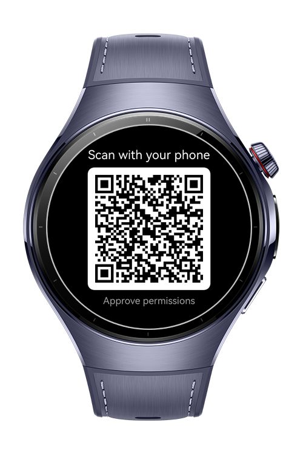
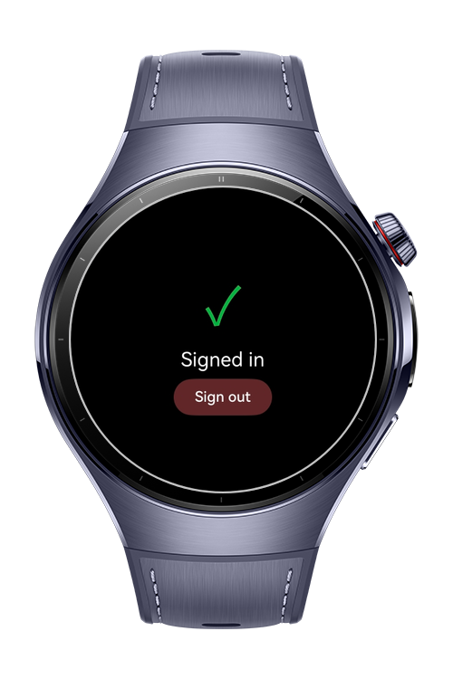
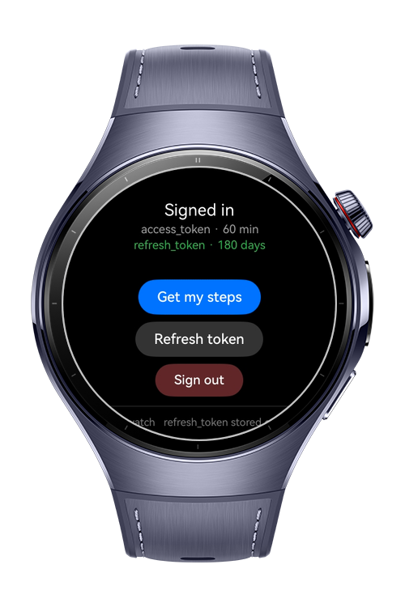
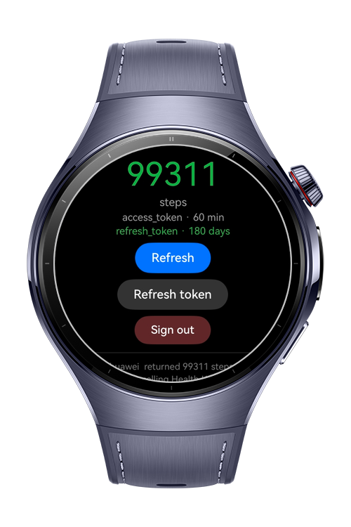

> **Note:** To access all shared projects, get information about environment setup, and view other guides, please visit [Explore-In-HMOS Index](https://github.com/Explore-In-HMOS/hmos-index).

# How To Use QR Health Login Standalone

A HarmonyOS NEXT watch application that signs in to Huawei Health Kit with a QR code and reads the user's step data. The watch has no keyboard, so the user scans the QR code with a phone and approves there. The app uses the OAuth 2.0 Device Code flow of Huawei Account Kit and runs fully on the watch, with no backend. Built with ArkTS and ArkUI, the project shows the full token lifecycle: getting a device code, polling for the token, renewing it with the refresh token and signing out by revoking consent. The MVVM structure keeps Huawei API calls in a separate service layer, so it is easy to add more health data types such as heart rate or sleep. Useful for developers who need Health Kit data on a watch without building a server.

# Preview

<div>
  
  
  
  
</div>

# Use Cases

* QR code sign-in on a watch with the Device Code flow
* Polling Huawei for the token
* QR code expiry after 2 minutes, with a refresh button
* Step data read straight from Health Kit with the access token
* Access token renewal with the refresh token, no new QR scan for up to 180 days
* Sign out by revoking consent, so the permission screen shows again next time
* Live activity log on the watch screen for each step of the flow
* MVVM architecture with a ViewModel and `@State` bindings

# Tech Stack

* Languages: ArkTS, ArkUI
* Frameworks: HarmonyOS NEXT SDK
* Tools: DevEco Studio NEXT
* Libraries:
    * `@kit.NetworkKit`
    * `@kit.ScanKit`
    * `@kit.ImageKit`

# Directory Structure

```
└── entry/src/main/ets/
    ├── common/
    │   ├── config/
    │   │   └── HuaweiConfig.ets
    │   └── utils/
    │       ├── ActivityLog.ets
    │       └── QrCodeFactory.ets
    ├── model/
    │   ├── AuthModels.ets
    │   ├── HealthModels.ets
    │   └── LoginUiState.ets
    ├── service/
    │   ├── DeviceAuthService.ets
    │   ├── HealthService.ets
    │   ├── HuaweiAuthApi.ets
    │   └── HealthApi.ets
    ├── viewmodel/
    │   └── DeviceLoginViewModel.ets
    └── pages/
        └── Index.ets
```

# Constraints and Restrictions

## Supported Devices

* Huawei Watch (HarmonyOS NEXT wearables)

## Notes

* Fill in your client ID, client secret and scopes in `common/config/HuaweiConfig.ets`. The scope list must include `openid`.
* The Health Kit scopes you request must be approved for your app in the Huawei Developer console.
* Add the `ohos.permission.INTERNET` permission to `module.json5`. Without it, requests fail with error code 201.
* The client secret is built into the watch app. For public apps, keeping the secret on a backend is the safer choice.

# License

**How To Use QR Health Login Standalone** is distributed under the terms of the MIT License. See the [LICENSE](LICENSE) for more information.
